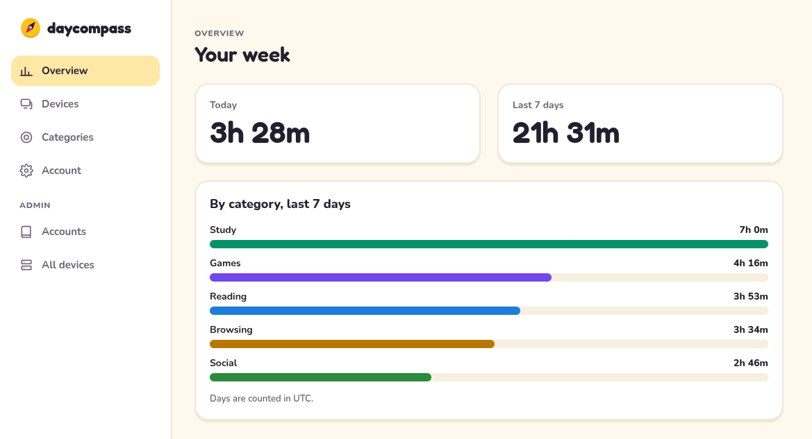
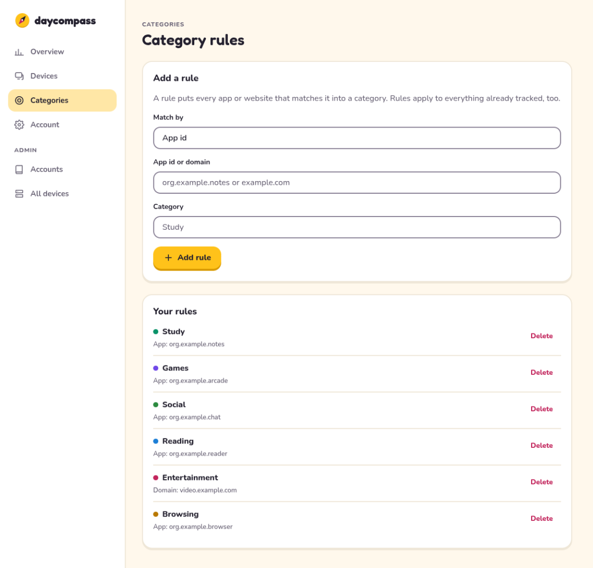
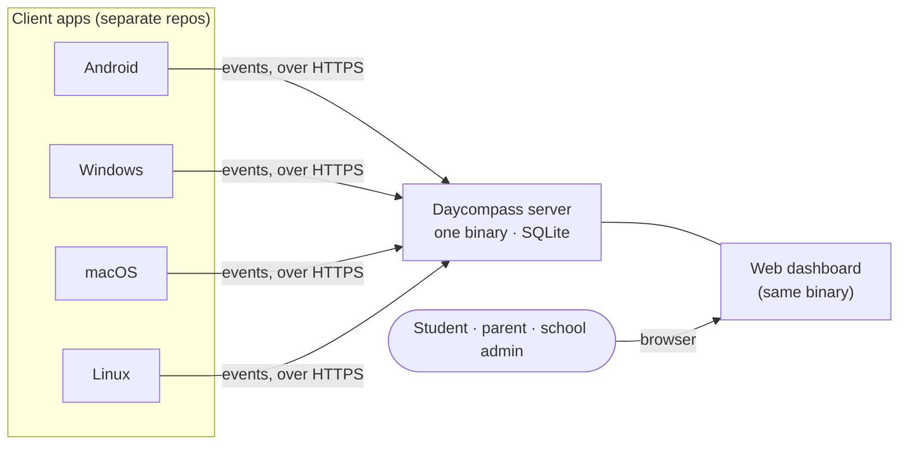

<div align="center">


# Daycompass

**Screen time for students, on a server you own.**<br>
Self-hosted, open source, and built so that nobody - not even the admin - can read someone else's data.

[](https://github.com/Daycompass/Daycompass/actions/workflows/ci.yml)
[](LICENSE)


[Quick start](#quick-start) · [Features](#features) · [Privacy model](#privacy-model) · [Configuration](#configuration) · [Docs](#documentation)

</div>

<br>

<p align="center">
  <picture>
    <source media="(prefers-color-scheme: dark)" srcset="docs/images/overview-dark.png">
    
  </picture>
</p>

Daycompass is a screen time backend you run yourself. Client apps on a
student's devices report which apps were in use and for how long; the
server keeps it, sorts it into categories you define, and shows a
dashboard of where the day went. There is no cloud service in the
middle, no account with a vendor, and no data that leaves your server.

> [!NOTE]
> This repository is the **backend** only: the JSON API and the web
> dashboard, served by one binary. The clients (Android first, then
> Windows, macOS and Linux) live in separate repositories and sync to
> this server. iOS is not planned.

## Features

- **One small binary, one container, one SQLite file.** No external
  database, no queue, no cache to operate.
- **Web dashboard built in.** Overview of today and the last seven days,
  devices, category rules, account settings and admin pages. Server
  rendered, with htmx served from the binary itself: no npm, no CDN, and
  a strict Content-Security-Policy. Light and dark mode.
- **Accounts by invite.** An admin creates an account; the person
  redeems their own invite and chooses their own password. An admin never
  sees or sets anyone's password.
- **Device pairing.** Mint a short code, type it on the new device, done.
  Devices have their own tokens and can be revoked at any time without
  losing the events they already reported.
- **Safe-to-retry sync.** Events carry a client-generated id, so a client
  can resend a batch as often as it likes without double counting.
- **Categories assigned at query time.** Rules map an app or a website to
  a category and apply to everything already tracked, so changing a rule
  never rewrites history.
- **Per-account time zone.** A day starts and ends where the student
  lives, including the days the clocks change.
- **Your data, your call.** Download everything an account holds as one
  JSON file, and optionally delete events after a number of days.
- **Documented API.** An [OpenAPI spec](docs/openapi.json), a written
  [wire format](docs/wire-format.md) for client authors, and a frozen v1
  contract that CI checks against.

<table>
  <tr>
    <td width="50%">
      <picture>
        <source media="(prefers-color-scheme: dark)" srcset="docs/images/categories-dark.png">
        
      </picture>
    </td>
    <td width="50%" valign="top">
      <h3>Rules, not guesses</h3>
      <p>Tell Daycompass once that <code>org.example.notes</code> is
      <i>Study</i> and <code>video.example.com</code> is
      <i>Entertainment</i>. Everything already tracked, and everything
      that arrives later, is sorted by those rules the moment you look at
      it.</p>
      <p>Each category keeps one colour everywhere in the dashboard.</p>
    </td>
  </tr>
</table>

## How it fits together



## Quick start

You need a container runtime (Podman or Docker). There is no prebuilt
image yet, so build it from this repository:

```sh
git clone https://github.com/Daycompass/Daycompass.git
cd Daycompass
podman build -t daycompass .          # or: docker build -t daycompass .

podman volume create daycompass-data
podman run -d --name daycompass \
  -p 127.0.0.1:8080:8080 \
  -v daycompass-data:/data \
  -e DAYCOMPASS_PUBLIC_URL=http://127.0.0.1:8080 \
  daycompass
```

`DAYCOMPASS_PUBLIC_URL` is the address you open in the browser. The
server checks the `Origin` of every state-changing request against it and refuses to start without
it. The value above is for trying Daycompass on your own machine; for a
real deployment set it to your HTTPS address instead, for example
`https://daycompass.example.com`, and see the note on TLS below.

**First start.** A fresh instance has no accounts, so the server prints
a single-use setup token to its output:

```sh
podman logs daycompass
```

Open <http://127.0.0.1:8080/setup>, paste the token, and choose the first
admin's username and password. From then on the setup page answers 404.
The token is valid for one hour and can be used once.

**Next:** open the dashboard, add an invite for each student under
*Accounts*, create a few category rules, and pair a device from the
*Devices* page once a client app is available.

<details>
<summary><b>Run from source instead</b></summary>

<br>

You need a Rust toolchain, version 1.95 or newer.

```sh
cargo run --release -p daycompass-server
```

By default it listens on `127.0.0.1:8080` and keeps its data in `./data`.
The setup token is printed to the terminal.

</details>

> [!IMPORTANT]
> The session cookie is `Secure` and uses the `__Host-` prefix, so
> browsers only keep it over HTTPS (loopback addresses excepted). Put
> the server **behind a TLS-terminating reverse proxy** and list that
> proxy in `DAYCOMPASS_TRUSTED_PROXIES`. Publish the container port on
> `127.0.0.1` only, as above. The details, including what the setup
> token means for container logs, are in the
> [operating guide](docs/guide.md). On a trusted home network without
> TLS there is an explicit, weaker opt-out
> (`DAYCOMPASS_INSECURE_COOKIES`), described there. It only helps
> browsers: native clients such as the Android app require HTTPS with a
> publicly trusted certificate. For a home network without open ports,
> see [HTTPS on a home network without open ports](docs/guide.md#https-on-a-home-network-without-open-ports)
> and the example in [`deploy/caddy-duckdns/`](deploy/caddy-duckdns/).

## Privacy model

Daycompass is meant for students and for schools, so the promises are
enforced in code and checked by tests, not left to policy.

- **An admin manages accounts and devices, never data.** There is no
  endpoint, and no parameter on any endpoint, that lets an admin read
  another account's events or stats. A test fails if one appears.
- **No telemetry, no outgoing requests.** The server never calls
  anything. Nothing to opt out of.
- **No browsing history.** Events record an app id and, for browsers, a
  bare hostname. There is no column for a window title or a URL, and a
  hostname field that carries a path is rejected.
- **No secrets in storage or logs.** Passwords are hashed with Argon2id,
  tokens are stored only as hashes, and logs name accounts by id rather
  than by username.
- **Security settings are environment-only.** Bind address, proxies,
  rate limits, Argon2 cost and the public URL cannot be changed through
  the API or the dashboard.
- **Hardened by default.** Per-session CSRF tokens, `Origin` checks,
  rate limits on login, pairing, invites, ingest and export, and a
  Content-Security-Policy that allows scripts, styles and fonts from the
  server itself and nothing else.

> [!WARNING]
> One honest limit: an admin can reset a student's password and, in
> principle, redeem the new invite before the student does. Every reset
> is written to the account's own log, but that does not prevent a
> takeover. [`docs/design-decisions.md`](docs/design-decisions.md)
> explains why the power exists and what it would take to close it.

## Configuration

Everything is configured through environment variables, and every
variable also accepts a `_FILE` form that reads the value from a mounted
secret. [`.env.example`](.env.example) lists all of them with
explanations. The ones you are most likely to touch:

| Variable | Default | What it does |
| --- | --- | --- |
| `DAYCOMPASS_PUBLIC_URL` | none | The origin people open, e.g. `https://daycompass.example.com`. **Required** unless the bind address is loopback. |
| `DAYCOMPASS_BIND_ADDR` | `127.0.0.1:8080` | Address and port to listen on. The container image uses `0.0.0.0:8080`. |
| `DAYCOMPASS_DATA_DIR` | `./data` | Where the SQLite database lives. Keep it on a volume. |
| `DAYCOMPASS_TRUSTED_PROXIES` | empty | CIDRs of your reverse proxy, so the real client address is used for rate limits. |
| `DAYCOMPASS_RETENTION_DAYS` | unset | Delete events older than this many days. Unset keeps events forever. |
| `DAYCOMPASS_MAX_DEVICES_PER_USER` | `20` | Devices one account may pair. |
| `DAYCOMPASS_INVITE_TTL_SECS` | `259200` (72 h) | How long an invite stays valid. |
| `DAYCOMPASS_SESSION_IDLE_SECS` / `_ABSOLUTE_SECS` | 7 d / 30 d | Session lifetime, from last use and from login. |
| `DAYCOMPASS_LOG` | `info` | `error`, `warn`, `info`, `debug` or `trace`. |

## Documentation

| | |
| --- | --- |
| [Operating guide](docs/guide.md) | First start, containers, reverse proxies, accounts, devices, the reasoning behind the non-obvious parts. |
| [Wire format](docs/wire-format.md) | Every endpoint, request and response. The reference for client authors. |
| [OpenAPI spec](docs/openapi.json) | Machine-readable API description. [`openapi-wire-v1.json`](docs/openapi-wire-v1.json) is the frozen v1 contract. |
| [Design decisions](docs/design-decisions.md) | Why things are the way they are. |
| [Security policy](SECURITY.md) | How to report a vulnerability privately. |

## Status

The backend is feature-complete for a first set of clients: accounts,
pairing, ingest, categories, stats, export, retention and the dashboard
all work and are covered by tests. It has not had a stable release yet,
so expect breaking changes until a client has shipped against it. The
first client will be Android.

## Contributing

Issues and pull requests are welcome; please open an issue before a
large change. Read [CONTRIBUTING.md](CONTRIBUTING.md) first, in
particular the rules about secrets and test data. To build and test:

```sh
cargo fmt --check
cargo clippy --all-targets --locked -- -D warnings
cargo test --locked
cargo deny check
```

## License

[AGPL-3.0-only](LICENSE). If you run a modified Daycompass as a network
service, you must offer its users the source of your changes.
